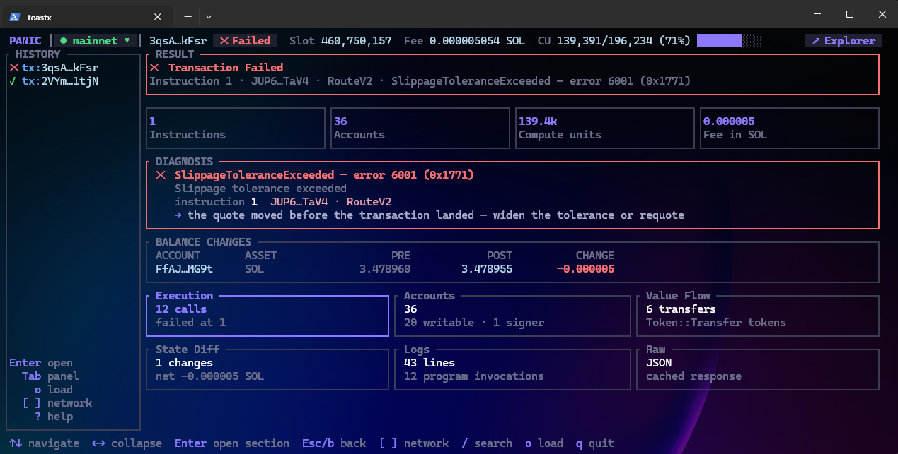
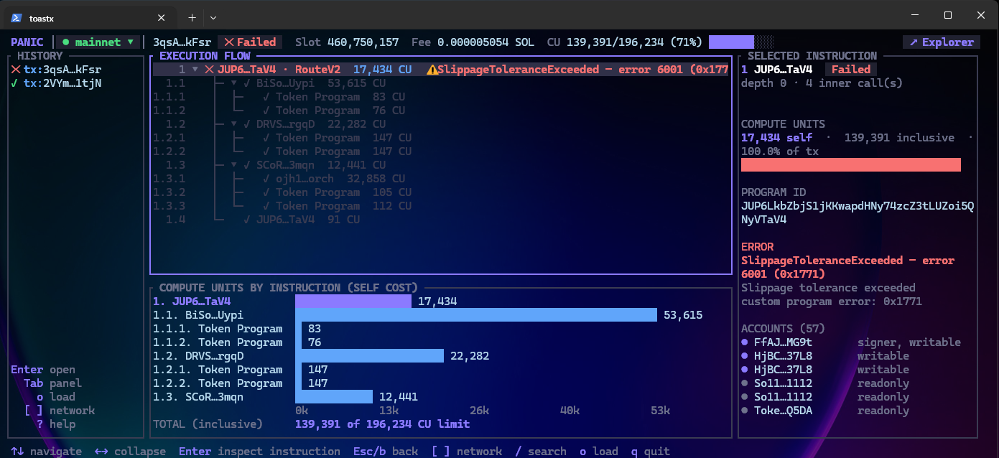
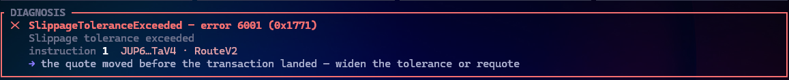
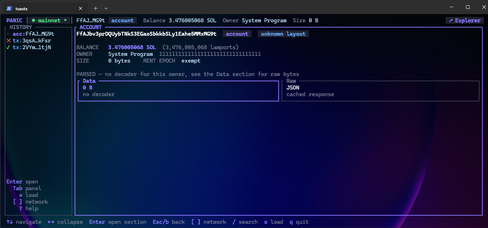

# panic at the program

A terminal debugger for Solana transactions. Paste a signature, see why it failed.

Explorers show you *what* happened. `panic` tries to tell you *why*: it decodes the error, names the instruction from program logs, chains your local IDLs to decode instructions and accounts, validates accounts against derived PDAs and token constraints, and runs heuristics that suggest a fix for common failures.

### Overview



## Install

macOS / Linux:

```sh
curl -fsSL https://raw.githubusercontent.com/toastx/panic-at-the-program/master/install.sh | sh
```

Windows (PowerShell):

```powershell
irm https://raw.githubusercontent.com/toastx/panic-at-the-program/master/install.ps1 | iex
```
### From source

```sh
cargo install --git https://github.com/toastx/panic-at-the-program
# or, from a clone
cargo install --path .
```

## Usage

```sh
panic                          # open the TUI on devnet
panic <signature>              # open a transaction
panic <pubkey>                 # open an account
panic <signature|pubkey> mainnet   # pick a cluster (mainnet, devnet, testnet, localnet, or a custom name)
panic test                     # run the project's test suite and open its first failure
```

### From the test suite

`panic test` finds the suite (`Anchor.toml` → `anchor test`, otherwise `cargo test`), runs it, and opens the TUI on a failed transaction from its output.

For Anchor it starts `solana-test-validator` itself and runs `anchor test --skip-local-validator`, so the failed transaction is still on the validator afterwards and opens with its accounts, balances and state diff. The validator is killed when you quit. An already-running localnet is reused instead of starting a second one.

For `cargo test` suites (litesvm, `solana-program-test`, mollusk) there is no validator: the transaction is rebuilt from the program logs in the test output, under a `tests` cluster. Execution tree, logs and diagnosis work; accounts and balances are empty.

### Custom RPC endpoints

```sh
panic rpc                      # list clusters and their URLs
panic rpc add <name> <url>     # save a custom endpoint
panic rpc rm <name>            # remove it
```

Custom endpoints live in `~/.config/panic/config.toml` and show up in the cluster menu alongside the built-ins.

## What you get

A transaction opens into a set of screens: **Overview**, **Execution** (weighted CPI tree with per-frame compute), **Invocation**, **Accounts**, **Flow** (token transfers), **State Diff**, and **Logs** (nested under their invocation frames). Accounts open into **Info**, **Data** (parsed through the IDL when one is found), and **Raw**.

<!-- screenshot: execution / CPI tree -->


<!-- screenshot: diagnosis with suggested fix -->


<!-- screenshot: account data decoded via IDL -->


## Keys

| Key | Action |
|-----|--------|
| `o` | Open a signature or pubkey |
| `/` then `n` | Search, jump to next match |
| `j` `k` / arrows | Move |
| `h` `l` | Collapse / expand, move between sidebar and screen |
| `Tab` / `Shift+Tab` | Toggle sidebar focus / cycle screens |
| `Enter` | Drill into the selected account, frame, or transfer |
| `b` / `Backspace` | Go back |
| `g` `G` | Top / bottom |
| `c` / `[` `]` | Cluster menu / previous, next cluster |
| `r` | Refetch |
| `x` | Open in explorer |
| `?` | Help |
| `q` | Quit |

Mouse clicks and scrolling work too.

## Workspace config

Run `panic` inside an Anchor (or any Cargo) project and it finds your IDLs in `target/idl`. Anchor, Shank, and Codama IDLs are supported. To override anything, add a `patp.toml` (or `.patp`) at the project root:

```toml
idl_dir = "target/idl"

[idl]
<program-id> = "path/to/idl.json"

[idl.kind]
<program-id> = "anchor"   # or "shank", "codama"

[errors.<program-id>]
6000 = "VaultLocked"      # name error codes your IDL doesn't
```

`panic` writes detected IDL kinds and unnamed error codes back into this file so you can fill in names later.

## Work in progress
- [ ] **Source Invokation** — invoke panic from the workspace but running tests and reading diagnosis.
- [ ] **Token Registry** — resolve mints to names, symbols, and decimals instead of raw pubkeys.
- [ ] **Program Registry** — known program IDs and their IDLs, so mainnet programs decode without a local workspace.
- [ ] **Import to AI Agents** — export a transaction's diagnosis as structured context for an AI agent.
- [ ] **What-if simulations** — tweak accounts or instruction data and re-simulate to test a fix before shipping it.
